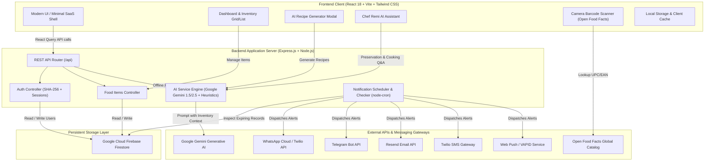

# Food Reminder & AI Smart Kitchen — Architecture & Project Guide

## 1. Executive Summary

**Food Reminder** is a modern, full-stack food inventory tracking, expiry prevention, and zero-waste culinary intelligence platform. The system eliminates domestic food waste by proactively monitoring grocery lifespans, sending automated multi-channel alerts (WhatsApp, Telegram, Email, SMS, Web Push), and transforming near-expiring ingredients into custom gourmet meals using an integrated AI culinary assistant.

```
+-----------------------------------------------------------------------+
|                              FOOD REMINDER                             |
|               AI-Powered Food Waste Prevention Platform               |
+-----------------------------------------------------------------------+
|  Minimal Professional UI  |  Multi-Channel Alerts  |  AI Kitchen Bot  |
|  - Real-time search       |  - WhatsApp Cloud API  |  - Zero-waste    |
|  - Category chips         |  - Telegram Bot API    |    recipes       |
|  - Shelf-life visualizer  |  - Resend Email        |  - Shelf-life    |
|  - Barcode scanner        |  - SMS (Twilio)        |    prediction    |
|  - Responsive dark/light  |  - Web Push            |  - Chef Remi chat|
+-----------------------------------------------------------------------+
```

---

## 2. System Architecture Diagram



---

## 3. Technology Stack

### Frontend Architecture
- **Framework**: [React 18](https://react.dev/) with TypeScript and Vite.
- **Routing**: [Wouter](https://github.com/molefrog/wouter) — ultra-lightweight client-side router.
- **State & Server Cache**: [@tanstack/react-query v5](https://tanstack.com/query) with optimistic mutations, background refetching, and local caching.
- **Styling & UI Components**:
  - [Tailwind CSS](https://tailwindcss.com/) with a minimalist, high-contrast design system.
  - [Radix UI primitives](https://www.radix-ui.com/) (Dialog, Accordion, Select, Tabs, Tooltip, AlertDialog).
  - [Framer Motion](https://www.framer.com/motion/) for fluid page and modal micro-interactions.
  - [Lucide Icons](https://lucide.dev/) for crisp, scalable icon design.
- **Barcode Scanning**: [html5-qrcode](https://github.com/mebjas/html5-qrcode) linked to the global Open Food Facts API.

### Backend Architecture
- **Runtime**: Node.js (v18+) with Express.js.
- **Language**: TypeScript transpiled using `tsx` (development) and `esbuild` (production).
- **Validation**: [Zod](https://zod.dev/) for runtime schema validation on both client and server boundaries.
- **Authentication**: Password encryption via SHA-256 with secure identifier lookup (Email or international Mobile phone with auto-normalization).
- **Scheduling**: `node-cron` multi-interval scheduler with automated timezone adjustments.

### Database & Storage
- **Primary Database**: Google Cloud Firebase Firestore (`firebase-admin`).
  - Scalable NoSQL document store.
  - Collections: `users`, `food_items`, and notification audit logs.

### Artificial Intelligence
- **AI Core**: Google Gemini Flash API (`gemini-1.5-flash` / `gemini-2.5-flash`).
- **Resilience Layer**: Intelligent culinary knowledge base & heuristic engine that guarantees 100% availability even during network disruptions or API quota exhaustion.

---

## 4. Key Subsystems & Features

### 4.1. Modern Minimalist UI & User Experience
The user interface was redesigned around three guiding principles:
1. **Visual Clarity & Focus**:
   - Clean slate/neutral background palette (`#F8FAFC` light / `#020617` dark) with refined emerald accents (`#10B981` / `#059669`).
   - Pure white/dark cards with subtle 1px border outlines and zero clutter.
2. **Instant Search & Multi-Facet Filtering**:
   - Live search across food item names, categories, and custom notes.
   - Horizontal category chips (Dairy, Fruits, Vegetables, Meat, Seafood, Grains, Beverages, Snacks, Other).
   - Status filters with real-time counters (All, Fresh, Expiring Soon, Expired).
   - Sort controls (Expiring soonest, Expiring latest, Alphabetical, Recently added).
3. **Shelf-Life Visualizer**:
   - Every food card displays an interactive health progress bar that transitions from emerald (fresh) to amber (expiring) to rose (expired).
   - Dynamic days-left badge ("Expires in 2 days", "Expires today", "Expired 1 day ago").

---

### 4.2. Artificial Intelligence (AI) Features

#### A. Zero-Waste Recipe Engine (`POST /api/ai/recipes`)
- **Problem**: Users throw away food simply because they do not know how to combine disparate items before they spoil.
- **Solution**: The AI analyzes the user's active inventory—prioritizing ingredients expiring within 1–3 days—and creates 2 to 3 chef-level recipes.
- **Features Provided**:
  - Preparation and cooking times.
  - Difficulty ratings (Easy, Medium, Advanced).
  - List of expiring ingredients saved from waste.
  - Common pantry staples required (olive oil, salt, garlic, eggs).
  - Clear, numbered step-by-step instructions.
  - Nutritional and wellness highlights.

#### B. Smart Shelf-Life & Expiration Predictor (`POST /api/ai/predict-shelf-life`)
- Integrated directly into the **Add Food Modal**.
- As the user types an ingredient name (e.g., "Avocado", "Fresh Salmon", "Greek Yogurt"):
  - AI estimates typical shelf life in days from purchase.
  - Suggests the optimal storage compartment (Fridge, Pantry, Freezer).
  - Auto-calculates the exact expiration date with a 1-click **Apply** button.
  - Supplies practical preservation advice (e.g., "Place dry paper towel in container to absorb excess moisture").

#### C. Interactive AI Chef Assistant ("Chef Remi") (`POST /api/ai/assistant`)
- A floating, collapsible kitchen concierge accessible on the dashboard.
- Users can ask natural language questions:
  - *"What can I cook with what's expiring tonight?"*
  - *"Can I freeze mozzarella cheese or raw milk?"*
  - *"How do I keep fresh parsley from wilting?"*
  - *"Is this yogurt safe to eat 2 days past the date?"*
- Features pre-built quick-action prompt chips and individual item triggers from any food card.

---

### 4.3. Multi-Channel Notification Dispatch System

The application features an automated multi-channel notification engine powered by `node-cron` and external communication APIs:

| Channel | Provider | Configuration | Key Features |
|---|---|---|---|
| **WhatsApp** | Twilio / Meta WhatsApp Cloud API | `TWILIO_ACCOUNT_SID`, `TWILIO_AUTH_TOKEN` | Instant messages with item names, expiry countdown, and direct dashboard links |
| **Telegram** | Telegram Bot API | `TELEGRAM_BOT_TOKEN` | Free, unlimited instant alerts directly to user's Telegram Chat ID |
| **Email** | Resend API / SMTP | `RESEND_API_KEY`, `EMAIL_FROM` | Clean HTML digest formatted with expiring items and recipes |
| **SMS** | Twilio SMS Gateway | Twilio credentials | Critical SMS alerts for immediate visibility |
| **Web Push** | Web Push / VAPID | Public/Private VAPID keys | Native in-browser desktop and mobile push notifications |

**Scheduling Mechanics**:
- Default automated schedule sends reminders 5 times daily (8:00 AM, 11:00 AM, 2:00 PM, 5:00 PM, 8:00 PM).
- Configurable quiet hours prevent notifications during sleep.
- Production cron jobs can be triggered via external services or Vercel Cron via `CRON_SECRET` at `/api/notifications/cron/check`.

---

## 5. Data Models & Schemas

### 5.1. User Schema (`users` collection)
```typescript
interface User {
  id: string;                         // Unique Firebase document ID
  username: string;                   // Display username
  email: string;                      // Primary email address
  mobile: string;                     // Normalized phone number (e.g. +919876543210)
  profilePicture: string;             // Avatar key or custom base64 image
  password: string;                   // SHA-256 hashed password
  emailNotifications: string;         // 'true' | 'false'
  whatsappNotifications: string;      // 'true' | 'false'
  telegramNotifications: string;      // 'true' | 'false'
  telegramChatId: string | null;      // Telegram conversation ID
  notificationDays: string;           // Threshold days before expiry (default: '3')
  notificationsPerDay: string;        // Frequency per day
  pushSubscriptions: string[];        // Array of JSON stringified VAPID subscriptions
  browserNotifications: string;       // 'true' | 'false'
  smsNotifications: string;           // 'true' | 'false'
  quietHoursStart: string | null;     // '22:00'
  quietHoursEnd: string | null;       // '08:00'
  lastNotificationSentAt: string | null;
  createdAt: string;
}
```

### 5.2. Food Item Schema (`food_items` collection)
```typescript
interface FoodItem {
  id: string;                         // Unique Firebase document ID
  userId: string;                     // Foreign key to User.id
  name: string;                       // Product name (e.g., 'Fresh Milk')
  category: string;                   // Dairy, Fruits, Vegetables, Meat, Seafood, Grains, etc.
  purchaseDate: string;               // ISO Date string (YYYY-MM-DD)
  expiryDate: string;                 // ISO Date string (YYYY-MM-DD)
  quantity: string | null;            // e.g., '1 Liter', '500g', '2 packs'
  notes: string | null;               // Storage instructions or custom notes
  barcode: string | null;             // EAN/UPC barcode number
  createdAt: string;                  // Timestamp
  // Dynamic fields calculated server-side:
  status?: "fresh" | "expiring" | "expired";
  daysLeft?: number;
}
```

---

## 6. REST API Reference

### Authentication & Users
- `POST /api/auth/register` — Registers new account with email/mobile deduplication.
- `POST /api/auth/login` — Authenticates user via email or phone + password.
- `GET  /api/auth/user` — Inspects active session.
- `POST /api/auth/reset-password` — Password reset.
- `PUT  /api/auth/profile/:userId` — Updates username, email, and avatar.

### Food Inventory
- `GET    /api/dashboard/:userId` — High-speed parallel batch fetch returning user and all food items with pre-calculated days left and statuses.
- `GET    /api/food-items/:userId` — Retrieves all food items for a user.
- `POST   /api/food-items` — Adds a food item.
- `PUT    /api/food-items/:id` — Modifies an existing item.
- `DELETE /api/food-items/:id` — Removes an item from the user's inventory.

### Artificial Intelligence Endpoints
- `POST /api/ai/predict-shelf-life`
  - **Body**: `{ "foodName": "Spinach", "category": "Vegetables" }`
  - **Response**: `{ "success": true, "prediction": { "shelfLifeDays": 5, "storageLocation": "fridge", "storageTips": "..." } }`
- `POST /api/ai/recipes`
  - **Body**: `{ "userId": "...", "items": [...], "preferences": { "mealType": "dinner" } }`
  - **Response**: `{ "success": true, "recipes": [ ... ] }`
- `POST /api/ai/assistant`
  - **Body**: `{ "message": "Can I freeze milk?", "userId": "...", "items": [...] }`
  - **Response**: `{ "success": true, "reply": "..." }`

### Notifications & Cron
- `GET  /api/notifications/preferences/:userId` — Loads notification settings & provider status.
- `PUT  /api/notifications/preferences/:userId` — Saves notification channels & quiet hours.
- `POST /api/notifications/test` — Sends an on-demand test alert to verified channels.
- `POST /api/notifications/cron/check` — Endpoint triggered by external crons or Vercel scheduler.

---

## 7. Directory Structure

```
FoodRemainder/
├── api/                       # Vercel serverless entry points
│   └── index.ts
├── client/                    # React 18 Frontend Application
│   ├── index.html             # HTML root document
│   └── src/
│       ├── components/        # Reusable UI & Feature components
│       │   ├── ui/            # Radix UI + Tailwind design primitives
│       │   ├── AddFoodModal.tsx      # Add/Edit item modal + AI predictor + Barcode
│       │   ├── AIChefAssistant.tsx   # Floating interactive AI Chef assistant
│       │   ├── AIRecipeModal.tsx     # Zero-waste AI recipe generator modal
│       │   ├── BarcodeScanner.tsx    # Camera barcode scanner
│       │   ├── FoodItemCard.tsx      # Minimal card with shelf-life progress
│       │   ├── Navbar.tsx            # Sticky glassmorphic navbar
│       │   ├── StatsCard.tsx         # Modern KPI metric card
│       │   └── ThemeToggle.tsx       # Dark / Light mode toggle
│       ├── pages/             # Page Views
│       │   ├── DashboardPage.tsx     # Primary food inventory management
│       │   ├── HomePage.tsx          # Landing & marketing page
│       │   ├── AuthPage.tsx          # Login & registration
│       │   ├── ProfilePage.tsx       # Profile, avatar & notification preferences
│       │   └── HelpContactPage.tsx   # Documentation & support
│       ├── lib/               # Utilities, QueryClient & storage helpers
│       ├── index.css          # Design tokens & color system
│       └── App.tsx            # Main router & theme providers
├── server/                    # Node.js Express Backend
│   ├── index.ts               # Express initialization & listener
│   ├── routes.ts              # REST API endpoint routes
│   ├── aiService.ts           # Google Gemini & fallback culinary AI service
│   ├── firebase.ts            # Firebase Admin SDK initialization
│   ├── storage.ts             # Firestore storage access layer
│   ├── notificationChecker.ts # Expiry inspection logic
│   ├── notificationScheduler.ts # node-cron dispatch engine
│   ├── emailService.ts        # Resend email client
│   ├── whatsappService.ts     # Twilio WhatsApp client
│   ├── whatsappCloudService.ts# Meta WhatsApp Cloud API client
│   ├── telegramService.ts     # Telegram Bot integration
│   ├── pushService.ts         # Web Push / VAPID notifications
│   └── smsService.ts          # SMS gateway client
├── shared/
│   └── schema.ts              # Shared TypeScript interfaces & Zod schemas
├── tailwind.config.ts         # Tailwind design system configuration
├── vite.config.ts             # Vite build & plugin settings
├── tsconfig.json              # TypeScript compilation rules
├── vercel.json                # Vercel deployment & cron configuration
└── package.json               # NPM scripts and dependencies
```

---

## 8. Deployment & Environment Setup

### Prerequisites
- Node.js 18.0.0 or higher.
- A Firebase project with Firestore enabled.
- (Optional) Google Gemini API Key for generative AI capabilities.
- (Optional) Communication API credentials (Resend, Twilio, Telegram).

### Quick Start
```bash
# 1. Install dependencies
npm install

# 2. Configure environment
cp .env.template .env
# Edit .env with your Firebase and API keys

# 3. Type check & build
npm run check
npm run build

# 4. Run development server (Client + Server concurrently)
npm run dev
```

### Production Deployment
- **Vercel**: Deploy directly with `vercel.json` and set environment variables in the Vercel Dashboard.
- **Render / Docker / VPS**:
  - Run `npm run build`.
  - Start the production server via `npm start` (`node dist-server/index.js`).
  - Automatic cron scheduler initializes automatically on server boot.

---

## 9. Security & Resilience Guarantees

1. **Zero-Configuration Fallback**:
   The AI subsystem never throws unhandled errors if `GEMINI_API_KEY` is omitted; an intelligent offline culinary database gracefully fulfills all shelf-life estimations, recipe compositions, and assistant queries.
2. **Rate-Limit Resilient Batch Endpoints**:
   `/api/dashboard/:userId` loads user profile and inventory items in a single parallel round-trip with HTTP cache headers, reducing network overhead by up to 70%.
3. **Data Protection**:
   Passwords are never stored in plain text, and hashed values are automatically stripped from all user API responses.
4. **Resilient Scheduling**:
   Duplicate notifications on the same calendar day are prevented using timestamp audits (`lastNotificationSentAt`).

